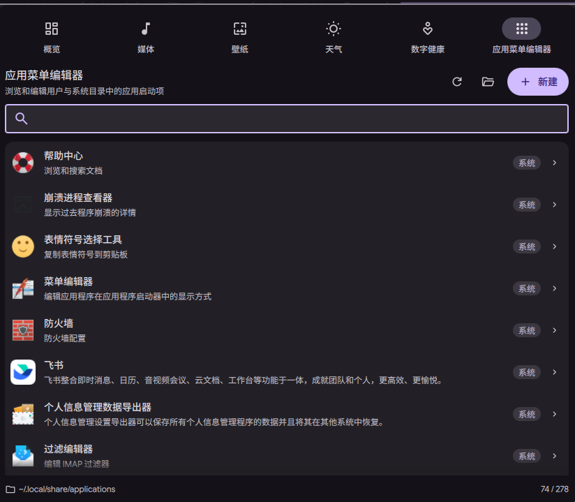

# App Menu Editor（应用菜单编辑器）



Dux Shell (DMS 2.0) 插件：在 Dash 里浏览用户和系统应用目录，创建、编辑、删除应用启动项（`.desktop` 文件），适合给没有自带 `.desktop` 文件的应用补一个启动器。

> Browse and edit application launchers from the dash. Scans user and system XDG application directories, hides `NoDisplay` entries by default, writes overrides to the user directory, and supports environment variables and automatic icon detection.

## 安装

把整个 `AppMenuEditor` 目录放到：

```text
~/.config/dms/plugins/AppMenuEditor/
```

然后让 DMS 重新扫描并启用插件：

```bash
dms ipc call plugin-scan scan
dms ipc call plugins enable appMenuEditor
```

如果插件已经加载，修改 QML 后可以热重载：

```bash
dms ipc call plugins reload appMenuEditor
```

## 打开

- Dash 顶部标签：**应用菜单编辑器**
- 应用启动器（Launcher）搜索：输入 `!app`，选择 **应用菜单编辑器**

命令行直接打开：

```bash
dms ipc call dash open plugin_appMenuEditor
```

## 数据来源

插件会扫描以下目录，并按 XDG 规则去重（用户目录优先）：

```text
~/.local/share/applications
$XDG_DATA_DIRS/*/applications
/usr/local/share/applications
/usr/share/applications
~/.local/share/flatpak/exports/share/applications
/var/lib/flatpak/exports/share/applications
/var/lib/snapd/desktop/applications
```

因此 Firefox、Clash Verge 等系统应用也会出现。默认不显示 `NoDisplay=true` 的条目，所以 Clash Verge 的协议处理入口（`clash-verge-handler.desktop`）不会出现，显示的是系统菜单里那个带 `Comment=Clash Verge Rev` 的 `Clash Verge.desktop`。

列表由 `scan.py` 一次性扫描并生成，不会为每个 `.desktop` 创建 QML 对象；只有点开某个条目编辑时才读取原文件内容，避免列表卡顿和内存占用。

如果希望在列表中看到隐藏条目，在 **设置 → 插件 → App Menu Editor** 里打开 **Show hidden entries**。

## 功能

- 列出用户目录和系统目录中的 `.desktop` 条目（XDG 应用目录）
- 默认隐藏 `Hidden=true` / `NoDisplay=true` 条目，可在插件设置中打开显示
- 用户目录中的同名条目优先于系统条目（符合 XDG 规则）
- 系统条目显示「系统」标记；编辑保存时会在用户目录创建同名覆盖项
- 系统条目不能直接删除；需要先保存为用户覆盖项，再删除覆盖项
- 搜索、显示/隐藏 `Hidden=true` / `NoDisplay=true` 条目
- 新建启动项：名称、命令、图标、注释、分类、是否在终端运行
- 支持配置多个环境变量，保存为 `env KEY=VALUE ...` 前缀
- 未填写图标时，会根据命令自动识别图标（例如 `clash-verge`）
- 编辑已有启动项，保留未知字段、本地化字段和 `[Desktop Action ...]` 分组
- 删除前需要二次确认
- 通过文件选择器挑选可执行文件（`kdialog` 或 `zenity`）
- 通过 KDE 图标选择器挑选图标（`kdialog`）
- “试运行”按钮可以在保存前测试命令
- 保存/删除后自动刷新 `update-desktop-database`，并在存在时刷新 `kbuildsycoca6/5`
- 支持中文界面（`translations/zh_CN.json`）

## 字段对应关系

| 界面字段 | `.desktop` 键 |
| --- | --- |
| 名称 | `Name` |
| 命令 | `Exec` |
| 图标 | `Icon` |
| 注释 | `Comment` |
| 分类 | `Categories` |
| 在终端中运行 | `Terminal` |

保存时会写入 `Type=Application`。`GenericName`、`Keywords`、本地化键（如 `Name[zh_CN]`）以及其它未知键不会被删除。

## 环境变量

在编辑器中点击“环境变量”旁边的“添加”，可以逐行填写变量名和值，支持多个变量。保存时会自动加在命令前面：

```ini
Exec=env http_proxy=http://127.0.0.1:7890 https_proxy=http://127.0.0.1:7890 /opt/app/app
```

如果值里包含空格，会自动加引号：

```ini
Exec=env "GREETING=hello world" /opt/app/app
```

编辑已有启动项时，如果 `Exec` 以 `env KEY=VALUE ...` 开头，会自动拆分回环境变量列表；“试运行”也会带上这些变量。

## 图标

图标字段可以填写图标主题名称（如 `firefox`）或绝对路径。留空时会按命令自动推断，例如：

- `Exec=/usr/bin/clash-verge %u` → `clash-verge`
- `Exec=flatpak run org.example.App` → `org.example.App`

自动推断只会在图标存在时写入 `Icon=`，不会写入无效名称。

## 文件名

新建时文件名由名称自动生成，例如 `My App` → `my-app.desktop`；如果重名会追加 `-2`、`-3`。文件只写入用户目录，不会修改 `/usr/share/applications`。

编辑系统条目时，保存会在 `~/.local/share/applications` 中创建同名覆盖文件。删除这个覆盖文件后，系统条目会重新出现。

## 依赖

- DMS 2.0+
- `python3`（用于一次性扫描所有应用目录，比逐个 QML 读取快很多）
- 可选：`kdialog`（可执行文件 + 图标选择器）或 `zenity`（可执行文件选择器）
- 可选：`update-desktop-database`、`kbuildsycoca6`/`kbuildsycoca5`（用于刷新桌面数据库）

没有文件选择器时仍然可以手动输入命令和图标名称。

## 注意

- 删除操作是直接删除文件，不进入回收站。
- 编辑已有文件会保留原有权限和未知字段，但会重排受管字段的顺序。
- 系统级 `.desktop` 会出现在列表中，但不会被直接修改；保存时会写入用户目录的同名覆盖项。

## 文件结构

```text
AppMenuEditor/
├── plugin.json
├── AppMenuTab.qml          # Dash 标签页（列表 + 编辑器）
├── AppMenuLauncher.qml     # !app 启动器入口
├── scan.py                 # 一次性扫描/解析所有应用目录
├── icon.svg                # 启动器彩色图标
├── translations/
│   └── zh_CN.json
└── README.md
```
