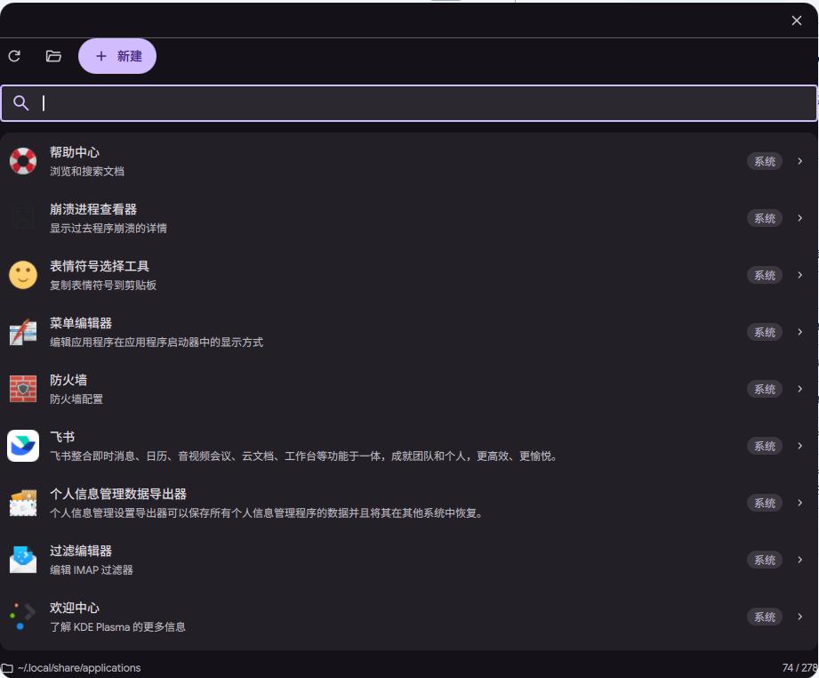
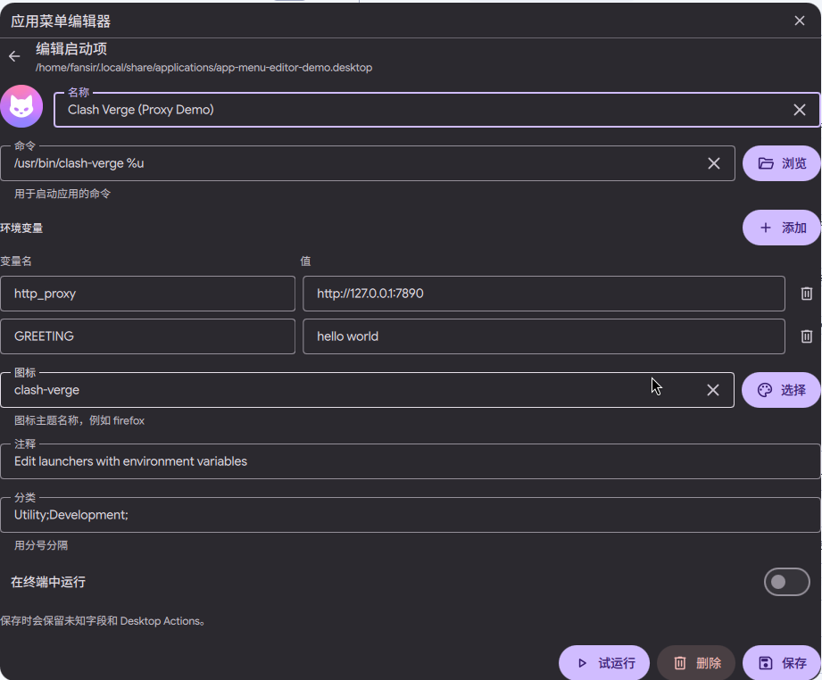

# App Menu Editor

English | [中文](README.zh.md)

| Floating overlay – browse | Floating overlay – edit |
| --- | --- |
|  |  |

A Dux Shell (DMS 2.0) plugin for browsing, creating, and editing application launchers (`.desktop` files) directly from the dash. It is useful for apps that ship without a launcher, and for overriding system entries without touching `/usr/share`.

## Features

- Scans user and system XDG application directories, not just `~/.local/share/applications`
- Floating layer-shell overlay, draggable anywhere and stays open when focus moves
- Resizable from any edge or corner
- Follows DMS floating-window transparency and blur settings
- Hides `Hidden=true` and `NoDisplay=true` entries by default, matching the system app menu
- User entries override system entries with the same file name (XDG precedence)
- System entries are marked with a **System** badge
- Editing a system entry writes a user override to `~/.local/share/applications`
- System entries cannot be deleted directly; save an override first, then delete the override
- Create and edit name, command, icon, comment, categories, and terminal mode
- Configure multiple environment variables, saved as an `env KEY=VALUE ...` prefix
- Parses existing `env` prefixes back into the variable editor
- Detects an icon from the command when `Icon=` is empty
- Optional executable picker (`kdialog` or `zenity`) and icon picker (`kdialog`)
- Test-run a command before saving
- Preserves unknown keys, localized keys, and `[Desktop Action ...]` groups
- One-shot `scan.py` scan keeps the list fast and avoids creating hundreds of QML objects
- Simplified Chinese translation included

## Installation

### From the plugin registry

After the plugin is listed in the registry:

```bash
dms plugins install appMenuEditor
```

Or open **Settings → Plugins → Browse** and search for **App Menu Editor**.

### Manual

Copy the plugin directory to:

```text
~/.config/dms/plugins/AppMenuEditor/
```

Then scan and enable it:

```bash
dms ipc call plugin-scan scan
dms ipc call plugins enable appMenuEditor
```

After changing QML files:

```bash
dms ipc call plugins reload appMenuEditor
```

## Open

- Launcher: type `!app` and choose **App Menu Editor** — opens the floating overlay
- Dash tab: **App Menu Editor** — includes an **Open in a floating window** button
- CLI:

```bash
dms ipc call appMenuEditor open
dms ipc call appMenuEditor toggle
dms ipc call appMenuEditor close
```

The overlay uses a Wayland layer-shell surface, so it floats above normal windows, can be dragged anywhere by its header, and stays open when you click another app or open a file picker. Drag any edge or corner to resize it. Its transparency and blur follow the DMS floating-window settings. It is not a tiled window. Close it with the **X** button or the `close` IPC command.

## Data sources

The plugin scans these directories in order and de-duplicates by desktop file name, with the user directory taking precedence:

```text
~/.local/share/applications
$XDG_DATA_DIRS/*/applications
/usr/local/share/applications
/usr/share/applications
~/.local/share/flatpak/exports/share/applications
/var/lib/flatpak/exports/share/applications
/var/lib/snapd/desktop/applications
```

This is why Firefox, Clash Verge, and other system applications appear. `NoDisplay` entries are hidden by default, so Clash Verge's protocol handler (`clash-verge-handler.desktop`) is hidden and the real `Clash Verge.desktop` entry with `Comment=Clash Verge Rev` is shown.

To include hidden entries, enable **Show hidden entries** in **Settings → Plugins → App Menu Editor**.

## Usage

### Browse

- Search by name, comment, command, file name, or category
- Click **Refresh** after installing or removing applications
- Click a row to edit it

### Create

Click **New**, fill in the fields, then **Save**. The file name is generated from the name, for example `My App` → `my-app.desktop`. If the name collides, `-2`, `-3`, etc. is appended.

### Edit

Click an existing entry. Saving preserves unknown keys, localized keys, and desktop actions.

For a system entry, saving creates an override in `~/.local/share/applications`. Deleting that override makes the system entry visible again.

### Delete

Deleting a user entry requires a second confirmation. System entries cannot be deleted directly; save an override first.

## Fields

| UI field | `.desktop` key |
| --- | --- |
| Name | `Name` |
| Command | `Exec` |
| Icon | `Icon` |
| Comment | `Comment` |
| Categories | `Categories` |
| Run in terminal | `Terminal` |

`Type=Application` is always written. `GenericName`, `Keywords`, localized keys such as `Name[zh_CN]`, and unknown keys are not removed.

## Environment variables

Click **Add** next to **Environment variables** to add rows of name/value pairs. Multiple variables are supported. They are written before the command:

```ini
Exec=env http_proxy=http://127.0.0.1:7890 https_proxy=http://127.0.0.1:7890 /opt/app/app
```

Values containing spaces are quoted:

```ini
Exec=env "GREETING=hello world" /opt/app/app
```

When editing an existing entry whose `Exec` starts with `env KEY=VALUE ...`, the prefix is split back into the variable list. **Test** also runs with those variables.

## Icons

The icon field accepts a theme icon name (for example `firefox`) or an absolute path. If it is left empty, the plugin infers an icon from the command:

- `Exec=/usr/bin/clash-verge %u` → `clash-verge`
- `Exec=flatpak run org.example.App` → `org.example.App`

An inferred icon is only written to `Icon=` when it resolves to an installed icon.

## Dependencies

- DMS 2.0+
- `python3` for the one-shot application scan
- Optional: `kdialog` or `zenity` for the executable picker
- Optional: `kdialog` for the icon picker
- Optional: `update-desktop-database`, `kbuildsycoca6`/`kbuildsycoca5` for refreshing desktop databases

Without a file dialog, commands and icon names can still be entered manually.

## Notes

- Deletion removes the file directly; it does not use the trash.
- Only the user application directory is written. System `.desktop` files are never modified.
- The plugin lists all entries from the XDG directories; the system menu may additionally filter `OnlyShowIn`/`NotShowIn`/`TryExec`.
- The `scan.py` scan takes roughly 60 ms for ~280 entries on a typical system; editing reads only the selected file.

## License

MIT. See [LICENSE](LICENSE).

Screenshots may contain third-party application icons and logos. Those remain the property of their respective owners and are used for identification only; the MIT license covers the plugin code and documentation, not third-party trademarks.

## File structure

```text
AppMenuEditor/
├── plugin.json
├── AppMenuTab.qml          # Dash tab: list + editor
├── AppMenuLauncher.qml     # !app launcher entry
├── AppMenuWindow.qml       # draggable layer-shell overlay
├── scan.py                 # one-shot application scanner
├── icon.svg                # colored launcher icon
├── screenshot.png          # registry preview (list + editor)
├── screenshot-list.png
├── screenshot-editor.png
├── README.md
├── README.zh.md
├── LICENSE
└── translations/
    └── zh_CN.json
```
